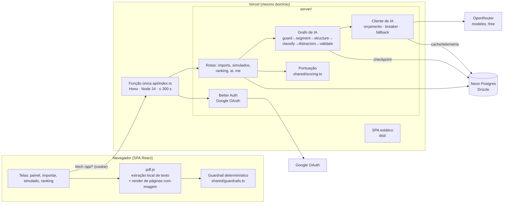
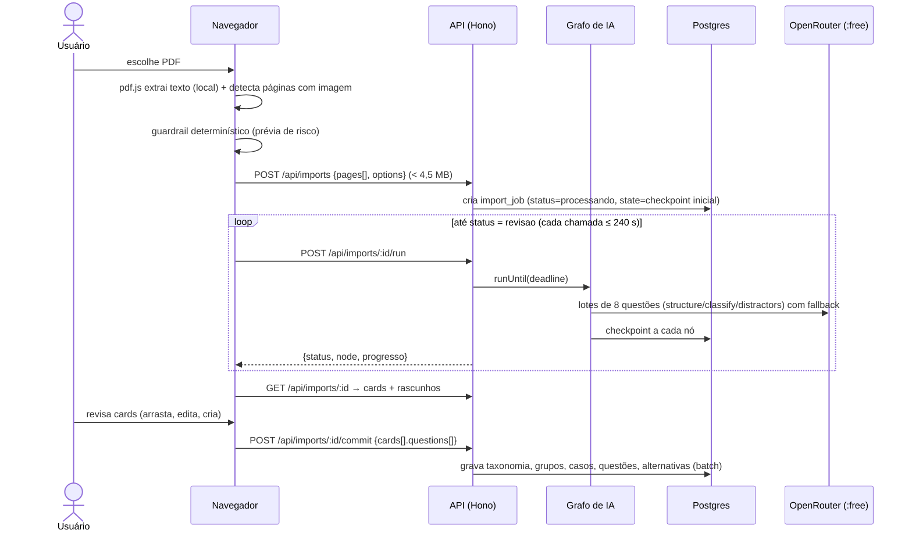
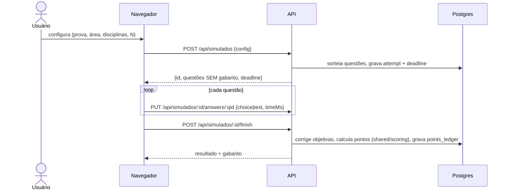

# 04 · Arquitetura

## 1. Visão de componentes



**Por que assim:** um único deploy Vercel serve o SPA e a API na mesma origem (cookies de sessão sem CORS); Postgres é a única peça com estado; tudo que é caro ou lento (PDF) acontece no navegador, gratuitamente.

## 2. Estrutura de pastas

```
deus-provera/
├─ .specify/memory/constitution.md   # princípios (Spec Kit)
├─ specs/NNN-feature/                # spec.md · plan.md · tasks.md · contracts/
├─ docs/                             # planejamento (este diretório)
├─ CLAUDE.md                         # memória do projeto para agentes de IA
├─ api/index.ts                      # entrada da função Vercel → server/app.ts
├─ server/                           # backend (Node)
│  ├─ app.ts                         # Hono: middlewares + rotas (/api/*)
│  ├─ env.ts · auth.ts · middleware.ts
│  ├─ db/{schema.ts, client.ts, migrations/}
│  ├─ routes/{questions,taxonomy,profile,imports,simulados,ranking,ai}.ts
│  ├─ services/taxonomy.ts
│  └─ ai/
│     ├─ models.ts                   # cadeias de modelos gratuitos por tarefa
│     ├─ client.ts · breaker.ts      # fallback em camadas, circuit breaker
│     ├─ graph.ts                    # mini state-graph com checkpoint
│     ├─ prompts.ts · schemas.ts · quality.ts
│     ├─ services.ts                 # explicar / corrigir (com cache)
│     └─ pipelines/import-graph.ts   # pipeline de importação
├─ shared/                           # regras puras usadas por cliente e servidor (+ __tests__)
│  ├─ domain.ts · scoring.ts · guardrails.ts · segmenter.ts
│  ├─ schemas/import.ts              # contrato JSON v2
│  └─ prompts/external-agent.ts      # prompt para o agente do usuário
├─ src/                              # frontend (React)
│  ├─ app/ (router, layout)  components/ (ui, ranking)  lib/
│  ├─ features/{auth,dashboard,import,questions,simulado,ranking,profile}/
│  └─ mocks/ (dados e "IA" do protótipo — substituídos pela API na Fase 1)
├─ vercel.json · drizzle.config.ts · vite.config.ts · tsconfig*.json · .env.example
```

## 3. Fluxos principais

### 3.1 Importação de PDF (com IA)



### 3.2 Simulado (modo prova)



## 4. API (visão geral)

| Método | Rota | Descrição | Spec |
|---|---|---|---|
| GET/POST | `/api/auth/*` | Better Auth (login Google, callback, sessão, logout) | 001 |
| GET | `/api/me` | Usuário da sessão + perfil | 001 |
| GET / PATCH | `/api/profile` | Ler / atualizar perfil e privacidade ([contrato](../specs/001-autenticacao/contracts/api-profile.md)) | 001 |
| DELETE | `/api/account` | Excluir conta (`{ confirm: "EXCLUIR" }`) | 001 |
| POST | `/api/imports` | Cria job (PDF texto ou JSON do agente) | 002 |
| POST | `/api/imports/:id/run` | Avança o pipeline até ~240 s | 002 |
| GET | `/api/imports/:id` | Status, cards e rascunhos | 002 |
| POST | `/api/imports/:id/commit` | Grava questões revisadas (idempotente; [contrato](../specs/002-importacao-questoes/contracts/api-imports.md)) | 002 |
| GET | `/api/imports` | Importações recentes (retomar as não salvas) | 002 |
| POST | `/api/simulados/:id/{hint,explain,ai-grade}/:itemId` | Dica, explicação e correção por IA no simulado (autorização pela tentativa) | 005 |
| POST | `/api/ai/distractors` | Distratores por IA (editor e revisão) | 005 |
| GET | `/api/cron/daily` | Rotina diária (Vercel Cron, `CRON_SECRET`): abandona simulados > 24 h, limpa `ai_call` > 90 dias | 003/005 |
| GET/POST/PUT/DELETE | `/api/questions[/:id]` | Banco: listar (minhas/comunidade), criar manual, editar, excluir — [contrato](../specs/002-importacao-questoes/contracts/api-questions.md) | 002 |
| GET | `/api/taxonomy` | Áreas e disciplinas (contagem de assuntos: S3) | 002/003 |
| POST | `/api/simulados` | Cria tentativa (sorteio no servidor) | 003 |
| GET | `/api/simulados/:id` | Tentativa (sem gabarito na prova em andamento) | 003 |
| PUT | `/api/simulados/:id/answers/:qid` | Salva resposta + tempo | 003 |
| POST | `/api/simulados/:id/finish` | Finaliza, corrige, pontua | 003 |
| GET | `/api/stats/me` | Painel do estudante (KPIs, nota, sequência, mapa por assunto, atividade, recentes) | 004 |
| GET | `/api/ranking?periodo=semana\|mes\|geral` | Ranking (`rows` + linha do usuário em `me`) | 004 |
| POST | `/api/ai/explain/:questionId` | Dica/explicação (cache compartilhado) | 005 |
| POST | `/api/ai/grade` | Correção de discursiva | 005 |
| POST | `/api/ai/distractors` | Gerar alternativas incorretas (editor) | 005 |

Contratos detalhados em `specs/*/contracts/`.

## 5. Frontend

- **Roteamento:** `/login`, `/` (painel), `/simulados`, `/simulados/:id` (modo foco, sem sidebar), `/simulados/:id/resultado`, `/questoes`, `/importar`, `/ranking`, `/perfil`.
- **Layout:** sidebar à esquerda (desktop) / barra inferior (mobile); **ranking no painel direito** do dashboard (≥ 1280 px) e abaixo do conteúdo em telas menores.
- **Estado:** no protótipo, `src/mocks/store.tsx` (Context + localStorage). Na Fase 1, cada ação vira chamada à API via um cliente tipado (`hc<AppType>` do Hono) e cache com TanStack Query (a adicionar).
- **Design system:** tokens no `@theme` (vinho `brand-*`, dourado `gold-*`, `canvas`, `ink`, `muted`, `line`), componentes em `src/components/ui.tsx`.
- **Code splitting:** pdf.js só é baixado ao escolher um arquivo; rotas pesadas viram `lazy()` na Fase 1.
