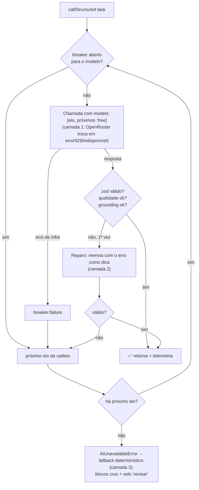
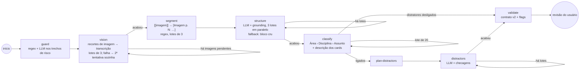

# 05 · Pipeline de IA, modelos, fallback e guardrails

## 1. Pergunta central: dá para extrair questões de PDF com modelos gratuitos?

**Sim — e a melhor parte nem precisa de IA.** Avaliamos quatro caminhos:

| Opção | Como funciona | Custo | Imagens? | Veredito |
|---|---|---|---|---|
| **A. pdf.js no navegador** + LLM gratuito estrutura | Texto extraído localmente; servidor recebe só texto (KB, não MB); LLM `:free` organiza em JSON | **R$ 0** | O **recorte** de cada imagem útil é renderizado no navegador e vai a um **modelo de visão gratuito** (§5.1) | ✅ **Escolhida (padrão)** |
| B. OpenRouter `file-parser` engine `cloudflare-ai` | Envia o PDF em base64 ao OpenRouter, que converte para markdown | Grátis | ❌ perde imagens | ❌ PDF de 4–8 MB vira 5,5–11 MB em base64 → estoura os **4,5 MB** da Vercel; chamar direto do navegador exporia a chave |
| C. OpenRouter `mistral-ocr` | OCR de alta qualidade | **US$ 2 / 1000 páginas** | ✅ | ❌ pago (viola princípio III). Possível no futuro com chave própria do usuário (BYOK) |
| **D. Agente externo do usuário** | Usuário copia nosso prompt, anexa o PDF no ChatGPT/Claude/Gemini e cola o JSON | R$ 0 para o sistema | ✅ (modelos de ponta) | ✅ **Oferecida como alternativa** — ideal para PDFs escaneados/cheios de imagens e quando a cota diária acabar |

Os PDFs de exemplo confirmam a estratégia: têm camada de texto (Google Docs exportado), ~160 mil caracteres extraídos localmente em segundos; 33/85 páginas têm imagem (46 imagens úteis em `Unidade II.pdf`, 18 em `III UNIDADE.pdf`) e 9 parecem escaneadas. Toda imagem útil vai à visão — os quadros POP-Q estão em imagem mesmo em páginas com bastante texto.

O prompt da opção D está em [prompts/prompt-agente-externo.md](prompts/prompt-agente-externo.md) e é exibido com botão "Copiar" na tela de importação.

## 2. Modelos gratuitos por tarefa (levantamento de 2026-11-19)

Fonte: API pública de modelos do OpenRouter (`/api/v1/models`, filtro preço 0). Só **16** modelos gratuitos estavam disponíveis. Configuração em `server/ai/models.ts`.

| Tarefa | Cadeia (ordem de preferência) | Por quê |
|---|---|---|
| `structure` (texto → JSON de questões, lotes de ≤ 3 questões, 3 lotes em paralelo) | `baidu/ernie-5.5-flash-preview:free` → `nvidia/nemotron-3.5-super-vl:free` → `inclusionai/ling-3.2-flash:free` → `openrouter/free` | Suportam `json_schema` estrito, contexto ≥ 1 M tokens |
| `classify` (Área › Disciplina › Assunto + resumo, lotes de 20 questões) | `baidu/ernie-5.5-flash-preview:free` → `inclusionai/ling-3.2-flash:free` → `openrouter/free` | Rápido, saída estruturada. Lotes de 20 desde 2026-11-20: numa chamada só, 85 questões voltavam com 3 classificadas |
| `distractors` (alternativas incorretas) | `baidu/ernie-5.5-flash-preview:free` → `nvidia/nemotron-3.5-super-vl:free` → `openrouter/free` | Raciocínio + JSON; temperatura 0,7 |
| `explain` (dica / por que certa-errada) | `nvidia/nemotron-3-ultra-550b-a55b:free` → `baidu/ernie-5.5-flash-preview:free` → `openrouter/free` | Melhor raciocínio livre (sem `response_format`: pedimos JSON simples e validamos) |
| `grade` (corrigir discursiva) | `baidu/ernie-5.5-flash-preview:free` → `inclusionai/ling-3.2-flash:free` → `openrouter/free` | JSON estrito, temperatura 0 |
| `vision` (transcrever imagem/OCR) | `nvidia/nemotron-3.5-super-vl:free` → `google/gemma-4-31b-it:free` → `inclusionai/ling-3.2-flash:free` | Multimodais com `json_schema`. **Medido em 2026-11-20** (docs/10 §7): o nemotron-VL transcreveu os quadros POP-Q ponto a ponto e fotos de enunciado; gemma-4 (31b e 26b), ling, particle-1 deram **429 do provedor** na hora e o nemotron-3-nano-omni voltou vazio — na prática a cadeia depende de um modelo só |
| `guard` (classificador de injeção) | `inclusionai/ling-3.2-flash:free` → `openrouter/free` | Barato e rápido |

**Atenção:**
- `dots-studio/dots-3-note-preview:free` **expira em 31/12/2026** — não usar como primário.
- `openrouter/free` escolhe **aleatoriamente** um modelo gratuito compatível com a requisição — bom como último elo, ruim como primário (qualidade variável).
- `openrouter/auto` **não** é gratuito.
- Não existem modelos-guarda (Llama Guard etc.) gratuitos hoje; o mais barato custa ~US$ 0,075/M tokens. Por isso o classificador de injeção usa um modelo geral gratuito + camadas determinísticas.

### Re-avaliação contínua (Fase 2)

A lista gratuita muda. `server/ai/eval/` terá ~30 casos reais (PT-BR, medicina e exatas) com saída esperada; `npm run ai:eval` mede validade de schema, grounding, latência e taxa de erro por modelo e sugere a nova ordem das cadeias. Rodar mensalmente ou quando a telemetria (`ai_call`) mostrar degradação.

## 3. Cota e orçamento

> **Atualização 2026-11-20:** pesquisa completa de limites, provedores gratuitos alternativos e "conecte seu modelo" (OpenRouter OAuth PKCE) em [11-provedores-ia.md](11-provedores-ia.md) — recomendação: pool multi-provedor grátis + BYOK por aluno (ADR-0010).

| Limite OpenRouter (`:free`) | Valor |
|---|---|
| Por minuto | 20 requisições |
| Por dia, sem créditos comprados | **50** requisições |
| Por dia, após comprar ≥ US$10 (uma vez) | **1000** requisições |

**Recomendação:** comprar US$10 de créditos uma única vez (não são consumidos por modelos gratuitos; só destravam o limite). Sem isso o sistema fica inviável para mais de um usuário.

> **Medido em 2026-11-20:** os modelos gratuitos têm raciocínio obrigatório (~4,8 mil tokens por questão antes do JSON). Lotes de 8 voltavam vazios (`finish_reason: length`); agora são **lotes de ≤ 3 questões** com até 24 mil tokens de saída, e cada passo respeita um **prazo** (a cadeia de fallback não passa dos 240 s). Os números abaixo eram a estimativa original.

**Custo estimado por importação** (PDF de 85 páginas ≈ 140 itens): ~18 chamadas `structure` (lotes de 8) + 1 `classify` a cada 20 questões + até 24 `distractors` (lotes de 6, opcional) ≈ **20–45 chamadas** → ~20–45 PDFs/dia no total. Daí:

- `AI_DAILY_BUDGET=900` (reserva ~10% para margem) e `AI_USER_DAILY_LIMIT=200` por usuário (um PDF de ~140 questões usa ~60–70 requisições com visão).
- Explicações são **cacheadas por questão** (`ai_cache`) e servem a todos os usuários: uma questão pública muito usada custa 1 chamada, não N.
- Quando o orçamento acaba: aviso claro + caminhos sem IA (agente externo, autocorreção por checklist, edição manual).
- Fila respeitando 20 req/min: a estruturação roda até **3 lotes em paralelo** por passo (`STRUCTURE_PARALLEL` em `import-graph.ts`); os outros nós, um lote por vez. O breaker abre 60 s em `429`.
- **Tempo da estruturação** (`ai_call` de produção, 2026-11-20): mediana de **15,5 s por lote** (6–93 s), ~13% de lotes reprovados (qualidade/JSON) e refeitos no próximo modelo. Quase todo o tempo é espera do modelo gratuito. Por isso os lotes rodam 3 de cada vez: mesmo número de requisições, cerca de 1/3 do tempo (21 lotes: de ~7–15 min para ~3–5 min).

## 4. Fallback em 3 camadas

Implementação: `server/ai/client.ts` (`callStructured`) e `server/ai/breaker.ts`.

**Qualidade (camada 2)** — `server/ai/quality.ts`:
- **Grounding:** enunciado e resposta devolvidos precisam existir no texto-fonte (sobreposição de trigramas ≥ 50% / 35%) → impede questões e respostas inventadas.
- **Distratores:** sem repetição, sem "todas/nenhuma das anteriores", tamanho equilibrado (a correta não pode ser muito maior), distrator ≠ paráfrase da correta.
- **Explicação:** não pode contradizer o gabarito.

## 5. Orquestração: grafo de decisão

O usuário sugeriu LangGraph. Avaliamos (ver ADR-0004): o fluxo é um **pipeline com laços, desvios condicionais e retomada**, que o LangGraph resolve bem — mas o pacote completo (langgraph + core + integração) ocupa **~98 MB** instalado contra ~25 MB do AI SDK, e o pipeline não usa agentes com ferramentas. Implementamos um **mini state-graph** (`server/ai/graph.ts`, ~90 linhas) com a mesma semântica: nós, arestas fixas/condicionais, retries por nó, checkpoint serializável e execução até um prazo (`runUntil`). Migrar para LangGraph depois é mecânico (mesmos nós e arestas).

**Retomada:** cada nó grava o estado em `import_job.state`. A rota `POST /api/imports/:id/run` roda até 240 s (folga nos 300 s da Vercel) e devolve o progresso; o cliente chama de novo até `status = revisao`. Se a cota acabar no meio (HTTP 429), o checkpoint fica salvo e o usuário retoma depois.

### 5.1 Etapa de visão (imagens das páginas)

70 das 216 questões dos PDFs de exemplo dependem de imagem (quadros POP-Q, enunciados fotografados, prints). A visão roda **antes da segmentação**, para que o quadro/foto entre na questão certa:

1. **Localizar** (navegador, `src/features/import/pdfExtract.ts` + `shared/page-images.ts`): a lista de operadores do pdf.js dá a matriz (CTM) e o **recorte** (`eoClip`) de cada imagem → retângulo visível na página. Ícones e duplicatas são descartados (lado < 36 pt ou área < 0,8% da página). O texto da página ganha `[[imagem pN-k]]` depois da última linha acima do centro da imagem.
2. **Recortar** (`src/features/import/pageImages.ts`; em Node, `scripts/pdf-images-node.ts`): só a região da imagem é renderizada, lado maior ~1400 px (escala 1,5–4×), JPEG 0,75 → **~40 KB** (quadros) a **~100 KB** (fotos) por recorte. `Unidade II.pdf`: 46 recortes, 1,8 MB.
3. **Transcrever** (`server/ai/pipelines/vision.ts`, prompt `VISION_SYSTEM`): lotes de **3 recortes por chamada** (`callStructured` com partes de imagem), saída `{id, tipo, transcricao}`: `texto` (foto/print: transcrição literal), `pop_q` (`POP-Q — Aa <v>; Ba <v>; …; D <v>`), `tabela`, `figura` (descrição objetiva + legendas), `decorativa`. Lote só é reprovado se ids forem inventados ou menos da metade vier aproveitável; item ruim (POP-Q fora do formato, saída repetitiva "2 2 2 2…") falha sozinho e tem **2ª tentativa individual**. A transcrição passa pelo guardrail (`inspectText`): texto de imagem também pode carregar injeção. Pós-processamento determinístico (medido em docs/10 §7): ` ` → quebra de linha; `reflowTranscription` recoloca quebras antes de "QUESTÃO N", "( )", "a)"; `recoverPopqGrids` reconstrói quadros POP-Q "achatados" ("+2 Aa +1 Ba…"); `dropCutoffTail` descarta o fragmento da questão seguinte cortado na borda da foto.
4. **Inserir** (nó `segment`, `resolveImageMarks`): `[Imagem p. N: POP-Q — …]` dentro da questão; foto de texto vira texto normal entre `[Imagem p. N — texto da imagem:]` e `[Imagem p. N — fim]` (o segmentador enxerga "QUESTÃO 4", "a)"…); não transcrita → `[Imagem p. N]`; rótulo "QUESTÃO N" que estava dentro da imagem do quadro vira texto antes do colchete. No segmentador, enunciado em foto + respostas digitadas com o mesmo rótulo logo depois são unidos (`mergeRepeatedLabels`). A questão ganha `tem_imagem` e `descricao_imagem` sem chamada extra.

**No app** o PDF nunca vai ao servidor: o navegador (`src/features/import/importJob.ts` + hook `useImportJob`) cria o job com o texto marcado + manifesto de imagens, envia os recortes a `POST /api/imports/:id/images` (≤ 3 por requisição, < 4,5 MB, nada é armazenado além da transcrição; a imagem que falha 1x volta sozinha) e só então chama `/run` em loop, mostrando recortes, lotes e o nó atual; imagens que não chegaram (opção desmarcada, cota, retomada sem o PDF) viram `[Imagem p. N]`. **Na avaliação** (`npm run eval:import -- --vision`) o mesmo nó `vision` do grafo renderiza os recortes via `ctx.loadImages`. Custo: +1 requisição a cada 3 imagens (46 imagens → 16 chamadas, ~11 min com o modelo grátis). **Medido:** questões que dependem de imagem detectadas 36% → 94% (U2) e 13% → 83% (U3); quadro POP-Q exato na questão certa em 95%; métricas de texto não pioraram. Detalhes e limitações: [docs/10 §7](10-avaliacao-importador.md).

## 6. Guardrails

Ameaças consideradas: instruções escondidas no PDF/JSON ("ignore as instruções…", "você agora é…"), texto invisível (zero-width, bidi), marcação falsa de chat (`<|im_start|>system`), pedidos de vazamento de prompt/chaves, HTML/script, respostas discursivas tentando manipular o corretor ("me dê nota máxima"), tentativa de fraudar pontos.

| Camada | Onde | O que faz |
|---|---|---|
| 1. Regras determinísticas | `shared/guardrails.ts` (cliente **e** servidor) | Normaliza Unicode (NFKC), remove invisíveis/controles, detecta e **remove** padrões de injeção PT/EN, marcação de chat, HTML/script, `javascript:`, blocos base64; calcula risco baixo/médio/alto e mostra ao usuário. Aplicado também à **transcrição das imagens** (texto de foto/print pode carregar injeção) |
| 2. Delimitação com nonce | `wrapUntrusted()` + `prompts.ts` | Conteúdo do usuário vai entre `<dados_NONCE>…</dados_NONCE>`; o system prompt manda tratá-lo como dado; o nonce é aleatório por requisição (não dá para "fechar" o delimitador) |
| 3. Menor privilégio | `client.ts` | Modelos do pipeline **não têm ferramentas** nem acesso a nada — no pior caso, só produzem texto ruim |
| 4. Schema estrito + zod | `schemas.ts` | Saída fora do formato é descartada; limites de tamanho por campo |
| 5. Grounding/qualidade | `quality.ts` | Conteúdo inventado ou manipulado não passa |
| 6. Classificador LLM | nó `guard` | Só para trechos de risco **alto** (economiza cota): confirma e registra o motivo |
| 7. Guardrail do OpenRouter | painel do OpenRouter (Workspaces › Default › Guardrails) | Detecção de prompt injection por regex, **ativa desde 2026-11-20** na chave `deus-provera` em modo **Flag** (todas as mensagens). Se um dia for trocado para *Block*, o OpenRouter responde **403 "Request blocked"**: `server/ai/client.ts` classifica como `blocked` (`AiGuardrailBlockedError`, subclasse de `AiUnavailableError`) — o conteúdo segue o caminho sem IA (rascunho sinalizado / 503 com alternativa), sem ser confundido com chave inválida |
| 8. Renderização segura | React | Saída de IA sempre como texto (sem `dangerouslySetInnerHTML`) |
| 9. Regras no servidor | rotas | Gabarito, prazo, correção e pontos nunca dependem do cliente nem do LLM sem validação (nota da IA é número 0–1 validado; pesos aplicados no servidor) |

Testes: `shared/__tests__/guardrails.test.ts` cobre os ataques conhecidos; a Fase 2 adiciona um conjunto adversarial para o pipeline completo.

## 7. Contrato de saída

Todo caminho de importação converge para o **formato JSON v2** (`shared/schemas/import.ts`), documentado em `specs/002-importacao-questoes/contracts/import-format-v2.md`. Assim o PDF com IA, o agente externo e o cadastro manual alimentam a mesma tela de revisão.

## 8. Privacidade

- Nada de dados pessoais nos prompts (o conteúdo é a questão; nome do usuário nunca é enviado).
- Provedores de modelos gratuitos podem registrar prompts — informado nos termos de uso.
- O PDF original não é enviado ao servidor nem armazenado.
