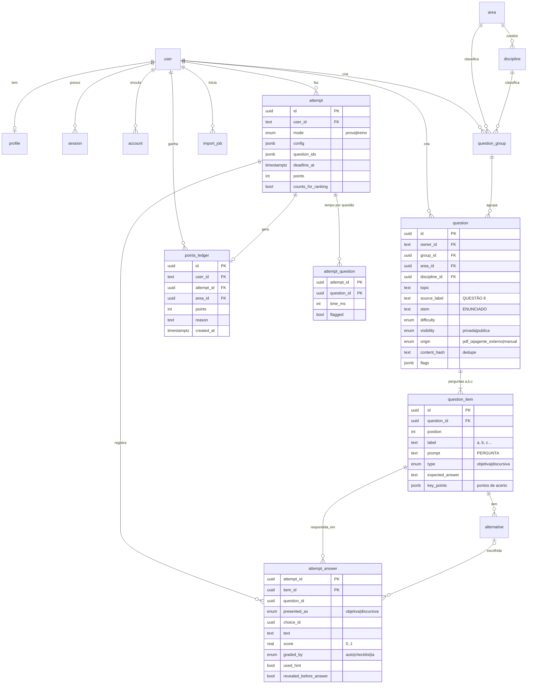

# 06 · Modelo de dados

Fonte da verdade: [`server/db/schema.ts`](../server/db/schema.ts) (Drizzle). Migrações em `server/db/migrations/` (`npm run db:generate` / `npm run db:migrate`).

## 1. Postgres ou MongoDB?

**Postgres (Neon)** — decisão registrada no ADR-0002.

| Critério | Postgres (Neon Free) | MongoDB Atlas M0 |
|---|---|---|
| Natureza dos dados | Usuários ↔ questões ↔ alternativas ↔ tentativas ↔ respostas ↔ pontos: **relacional** | Documentos aninhados ajudariam só na questão |
| Ranking (somas por período/área, posição do usuário) | `SUM … GROUP BY`, janelas, índices — nativo | Aggregation pipeline, mais verboso |
| Integridade (pontos, gabarito) | FKs, transações/batch, `UNIQUE` | Sem FKs |
| Flexibilidade | `JSONB` para config do simulado, checkpoint da IA, cache | Nativa |
| Limites gratuitos | **1 GB**/projeto, 100 CU-h/mês, branches por preview | **0,5 GB**, 100 ops/s, pausa após 30 dias sem conexão |
| Integração Vercel | Marketplace injeta `DATABASE_URL` (pooled) e `DATABASE_URL_UNPOOLED` | Marketplace também, mas limites menores |

Estimativa de volume: 1 questão ≈ 2–4 KB (com alternativas e explicações) → 1 GB comporta **~250 mil questões**, muito acima do MVP.

## 2. Diagrama ER



Tabelas de apoio: `verification` (Better Auth), `import_job` (checkpoint do pipeline), `ai_cache` (respostas de IA reutilizáveis), `ai_call` (telemetria/orçamento).

## 3. Decisões de modelagem

| Decisão | Motivo |
|---|---|
| `area`/`discipline` **globais** e `question_group` **por usuário** | Taxonomia compartilhada permite simulados com questões da comunidade ("Ginecologia" é a mesma para todos); o card (assunto + descrição) é do dono |
| `topic` (assunto) como texto em `question` e `question_group` | Assuntos variam muito; normalizar cedo demais engessa. Índice `(discipline_id, topic)` atende os filtros |
| **Questão = enunciado + perguntas** (`question` + `question_item`) | É como as provas são: um caso clínico com subitens a, b, c, cada um com a sua resposta. O enunciado fica na questão; resposta esperada, pontos de acerto e alternativas ficam em cada pergunta. Uma pergunta pode ter **as duas** formas (discursiva + alternativas geradas por IA) |
| Resposta e pontuação **por pergunta**, tempo **por questão** (`attempt_answer` × `attempt_question`) | O aluno lê o enunciado uma vez e responde as perguntas na mesma tela; cada pergunta é corrigida (auto, checklist ou IA) e pontua separadamente |
| `content_hash` único por dono | Reimportar o mesmo PDF não duplica questões |
| `attempt.question_ids` em JSONB | Ordem sorteada imutável da tentativa; respostas ficam normalizadas em `attempt_answer` |
| `deadline_at` no servidor | Modo prova: respostas após o prazo (+15 s de tolerância) são ignoradas |
| `points_ledger` append-only | Ranking por período = `SUM` filtrado; auditável; correções viram lançamentos de ajuste |
| Soft delete (`deleted_at`) em `question` | Tentativas antigas continuam consistentes |
| `timesAnswered/timesCorrect` em `question` | Dificuldade "real" da comunidade sem varrer respostas |

## 4. Índices principais

- `question(visibility, area_id, discipline_id, type)` — sorteio do simulado.
- `question(discipline_id, topic)` — filtros por assunto.
- `question(owner_id, content_hash)` UNIQUE **parcial** (`WHERE deleted_at IS NULL`) — dedupe; excluir (soft-delete) e recadastrar o mesmo conteúdo é permitido.
- `attempt(user_id, started_at)` — histórico/dashboard.
- `attempt_answer(question_id)` — caderno de erros / estatística por questão.
- `points_ledger(created_at, user_id)` — ranking por período.
- `ai_call(created_at)` — orçamento diário.

## 5. Consultas de referência

**Ranking da semana**

```sql
SELECT l.user_id, u.name, SUM(l.points) AS pontos
FROM points_ledger l
JOIN "user" u ON u.id = l.user_id
LEFT JOIN profile p ON p.user_id = l.user_id
WHERE l.created_at >= date_trunc('week', now() AT TIME ZONE 'America/Sao_Paulo')
  AND coalesce(p.show_in_ranking, true)
GROUP BY l.user_id, u.name
ORDER BY pontos DESC
LIMIT 50;
```

**Nota de desempenho (30 dias, prova peso 2)**

```sql
SELECT round(10 * SUM(a.score * CASE t.mode WHEN 'prova' THEN 2 ELSE 1 END)
              / NULLIF(SUM(CASE t.mode WHEN 'prova' THEN 2 ELSE 1 END), 0), 1) AS nota
FROM attempt_answer a JOIN attempt t ON t.id = a.attempt_id
WHERE t.user_id = $1 AND t.finished_at >= now() - interval '30 days' AND a.score IS NOT NULL;
```

## 6. Retenção e LGPD

- Exclusão de conta: `ON DELETE CASCADE` remove sessões, perfil, tentativas, pontos, jobs e questões; questões **públicas** já usadas por outros são transferidas para um usuário técnico "Comunidade" (anonimização) em vez de apagadas — a definir na spec 001.
- `import_job.state` é limpo 7 dias após `concluida` (rotina diária via Vercel Cron, Fase 2).
- `ai_call` agregado e truncado após 90 dias.
