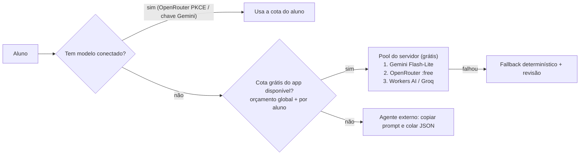

# 11 · Provedores de IA: limites, alternativas e "traga seu modelo"

Pesquisa feita em **2026-11-20** em documentação oficial (links em cada item). Limites de planos gratuitos mudam com frequência — revalide antes de lançar.

## 1. O limite de 50 requisições/dia do OpenRouter é verdade?

**Sim.** Para modelos `:free` ([docs de limites](https://openrouter.ai/docs/api/reference/limits)):

| Situação da conta | Limite |
|---|---|
| Comprou **menos de US$10** em créditos (somando a vida toda) | **20 req/min** e **50 req/dia** |
| Comprou **US$10 ou mais** (uma vez basta) | 20 req/min e **1000 req/dia** |

- O limite é da **conta**: criar mais chaves ou contas "não afeta os limites" (e várias contas violariam os termos).
- Saldo negativo pode gerar erro 402 **até nos modelos gratuitos**.
- O próprio FAQ diz que modelos gratuitos "geralmente não são adequados para produção" — a lista muda e a disponibilidade oscila (por isso temos cadeia de fallback).
- Alguns provedores gratuitos registram/treinam com os prompts (configurável na conta): **nunca envie dados pessoais**; conteúdo de questões é ok.

## 2. Dá para usar o Gemini da conta Google do aluno (já que ele loga com Google)?

**Não — e tentar é arriscado.**

- O login Google (OAuth) identifica o usuário, mas **não dá acesso à assinatura/cota do Gemini dele**. A API do Gemini cobra/conta cota por **projeto do Google Cloud**; para "o usuário pagar", cada aluno teria de criar um projeto no Cloud, ativar a API e configurar faturamento ([guia OAuth](https://aistudio.google.com/docs/oauth), [quota project](https://docs.cloud.google.com/docs/quotas/quota-project)).
- O escopo `generative-language.peruserquota`, que parecia servir para isso, é relatado como **obsoleto e não documentado**, com cobrança caindo no projeto do desenvolvedor ([fórum](https://discuss.ai.google.dev/t/unexpected-billing-when-using-gemini-api-with-oauth-scopes-and-deprecated-peruserquota-scope/95821)).
- Usar a assinatura **Google AI Pro/Ultra** (app do Gemini) a partir de outro app viola os termos; contas — inclusive pagantes — foram **suspensas** por isso em 2026 ([The Register](https://www.theregister.com/2026/02/23/google_antigravity_compute_burden/)).
- Apps "Build" do AI Studio compartilhados usam a cota **do dono do app**, não de quem usa.

## 3. Alternativas gratuitas (ou quase)

| Provedor | Gratuito hoje | Bom para | Observações |
|---|---|---|---|
| **Gemini API (AI Studio) — chave do desenvolvedor** | Por projeto; RPD por modelo só aparece logado no AI Studio. Relatos (não oficiais): ~500 req/dia no Flash-Lite, ~20/dia no Flash mais novo ([pricing](https://aistudio.google.com/docs/pricing), [limites](https://aistudio.google.com/docs/rate-limits)) | Estruturar PDFs (contexto longo, JSON schema, visão, ótimo português) | ⚠️ Termos do plano grátis: dados usados para melhorar produtos e revisão humana; usuários **18+**; "uso profissional, não consumidor" ([termos](https://aistudio.google.com/docs/terms)). Disponível no Brasil |
| **OpenRouter `:free`** | 50/dia (1000/dia com US$10 únicos) | Fallback com vários modelos | Já integrado (`server/ai/models.ts`) |
| **Groq (free)** | ~30 req/min, ~1000 req/dia, **8K tokens/min**, 200K tokens/dia por modelo ([limites](https://console.groq.com/docs/rate-limits)) | Chamadas **curtas**: correção de discursiva, explicações, dicas | JSON schema estrito em gpt-oss/qwen; não retém dados por padrão |
| **Cloudflare Workers AI** | 10.000 "Neurons"/dia ≈ 30–75 chamadas médias ([pricing](https://developers.cloudflare.com/workers-ai/platform/pricing/)) | Fallback; **não treina com seus dados** | Gemma 4, gpt-oss-120b, Llama 3.3; JSON mode só em alguns modelos |
| SambaNova (free) | 20 req/dia por modelo | Pouco útil | — |
| Mistral, Cerebras, Together, Fireworks, Hugging Face | Sem plano gratuito permanente para API | — | Descartados |
| GitHub Models | **Descontinuado** em jul/2026 | — | — |
| NVIDIA build | Só para protótipo/teste (termos) | — | Proibido em produção |
| Google Cloud trial (US$300) | **Não cobre Gemini** para contas novas | — | — |
| Chrome Prompt API (Gemini Nano no navegador) | Grátis, local | — | **Não suporta português**; só desktop com GPU |
| WebLLM (modelo no navegador) | Grátis, local | — | Downloads de GBs; inviável em celular |

## 4. "Conecte seu próprio modelo" (BYOK) — as opções que funcionam

| Opção | Como funciona | Avaliação |
|---|---|---|
| **⭐ Conectar conta OpenRouter (OAuth PKCE)** | Botão "Conectar OpenRouter" → usuário autoriza → o app recebe uma **chave do próprio usuário** (com limite de gasto e validade que o app sugere e o usuário pode mudar). Uso cobrado/limitado na conta dele ([docs](https://openrouter.ai/docs/guides/overview/auth/oauth)) | **Recomendado.** Oficial, 1 clique, revogável, funciona até do navegador (CORS liberado). Cada aluno ganha os próprios 50/dia grátis (ou 1000/dia se ele comprar US$10) |
| Colar chave do Gemini (AI Studio) | Aluno cria chave grátis no AI Studio e cola no app; chamadas podem ir **direto do navegador** (a chave nem passa pelo servidor) | Funciona e dá a maior cota por aluno, mas os termos são **zona cinzenta** ("não para consumidores", 18+). Deixar como opção avançada, com aviso |
| Puter.js ("o usuário paga") | Aluno entra numa conta Puter; cota mensal grátis por usuário, depois ele paga | Possível como extra; exige 2ª conta e cota não divulgada |
| **Agente externo (copiar/colar)** | Já existe: prompt pronto para ChatGPT/Claude/Gemini do aluno | Custo zero e ilimitado; ótimo com imagens; manual |

## 5. Arquitetura recomendada (custo zero para o desenvolvedor)

**Por tarefa (pool do servidor):**
- Estruturar PDF e visão: Gemini Flash-Lite → OpenRouter `:free` (Gemma 4 / Nemotron VL) → Workers AI.
- Corrigir discursiva, explicar, dica (chamadas curtas): Groq → Workers AI → OpenRouter.

**Capacidade estimada** (1 PDF ≈ 20–45 chamadas hoje; ~150–350 mil tokens):

| Fonte | PDFs/dia |
|---|---|
| OpenRouter grátis, chave única, sem créditos | **1–2 para o app inteiro** |
| OpenRouter após US$10 únicos | 22–50 para o app inteiro |
| Gemini Flash-Lite grátis (se ~500/dia se confirmar) | 11–25 para o app inteiro |
| Pool do servidor somado (US$0) | ~16–36 para o app inteiro |
| **Cada aluno com OpenRouter conectado** | **1–2 por aluno** (22–50 se ele comprar US$10) |
| Cada aluno com chave Gemini | 11–25 por aluno |
| Agente externo | ilimitado (manual) |

**Maiores ganhos sem gastar nada:**
1. ~~Lotes maiores~~ — **refutado na prática (2026-11-20):** os modelos gratuitos bons (ernie, nemotron, ling) têm **raciocínio obrigatório** e gastam ~4,8 mil tokens "pensando" por questão; lotes de 8 questões estouravam o limite e voltavam vazios. Hoje: **lotes de até 3 questões**, saída de até 24 mil tokens (grátis). Isso aumenta as chamadas por PDF (~25–30 para ~80 questões) — com 1000 req/dia, ~30 PDFs/dia. Para lotes maiores, só com modelo sem raciocínio obrigatório (ex.: Gemini Flash-Lite no pool, a testar).
2. **Cache por hash do PDF**: a mesma apostila da turma é processada uma vez só para todos.
3. **Regras antes da IA** (já feito: o segmentador resolve ~90% das questões com texto; a IA só refina).
4. Explicações cacheadas por questão (já previsto).

## 6. Recomendação final (em ordem)

1. **Implementar o pool multi-provedor** (Gemini Flash-Lite + OpenRouter + Groq/Workers AI) com o AI SDK (`createProviderRegistry`, pacotes `@ai-sdk/google`, `@ai-sdk/groq`, `workers-ai-provider`, `@openrouter/ai-sdk-provider`) — trocar provedor vira configuração em `server/ai/models.ts`.
2. **"Conectar OpenRouter" (OAuth PKCE)** no perfil do aluno — escala sem custo para você.
3. Manter o **agente externo** como caminho sempre disponível.
4. Se puder gastar **US$10 uma única vez** no OpenRouter, o pool do servidor sobe de 50 para 1000 req/dia — o melhor custo-benefício disponível.
5. Chave Gemini colada pelo aluno: só como opção avançada, com aviso de termos.
6. **Não** tentar usar o login Google para gastar a cota do Gemini do aluno.

> ⚖️ Atenção aos termos do Gemini grátis (18+, "não para consumidores", dados usados para treino) e à política de privacidade do app: informe que o conteúdo das questões pode ser processado por provedores de IA de terceiros.
