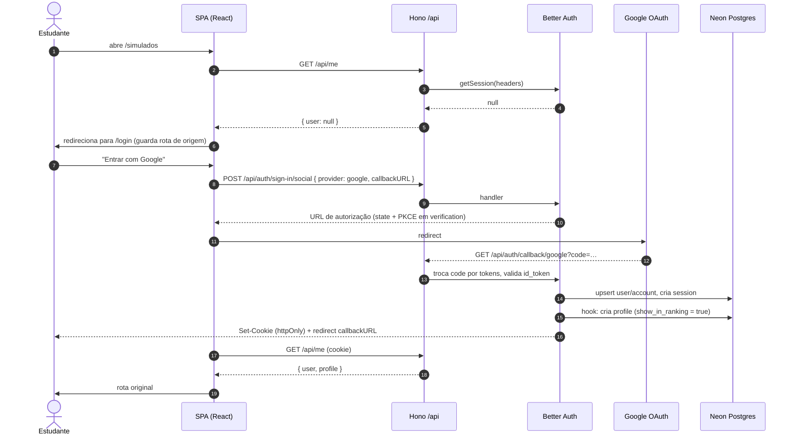

# Plano técnico — 001 Autenticação e perfil

**Spec**: [spec.md](./spec.md) · **Tarefas**: [tasks.md](./tasks.md)

## Resumo da abordagem

A identidade usa **Better Auth** com provedor Google e adaptador Drizzle (`provider: 'pg'`), montado dentro da função Hono única em `/api/auth/*`. Um `sessionMiddleware` carrega a sessão em `c.var.user` para todas as rotas, e `requireUser` protege as rotas de dados. No SPA, um `AuthProvider` consulta `GET /api/me` na inicialização e um guard de rota substitui o login simulado do protótipo (`useStore().loggedIn`). O cliente de API centraliza o tratamento de 401. Perfil e privacidade ficam na tabela `profile`, criada por hook do Better Auth no primeiro login.

## Contexto técnico

| Item | Escolha |
|---|---|
| Runtime | Node 24 (Vercel Functions, Fluid compute), `engines: 24.x` |
| API | Hono 4.13 — `server/app.ts` com `basePath('/api')`, exportado em `api/index.ts` |
| Auth | Better Auth 1.7 (`better-auth`, `better-auth/adapters/drizzle`, `better-auth/react` no cliente) |
| Banco | Neon Postgres (Vercel Marketplace) + Drizzle ORM 0.45 (driver `neon-http`) |
| Cliente | React 19 + React Router 8 (data mode) |
| Segredos | `BETTER_AUTH_SECRET`, `BETTER_AUTH_URL`, `GOOGLE_CLIENT_ID`, `GOOGLE_CLIENT_SECRET` (validados em `server/env.ts`) |
| Callback OAuth | `{BETTER_AUTH_URL}/api/auth/callback/google` (produção + `http://localhost:3000`) |
| Dev local | `npm run dev:api` (Vite com a API Hono montada em `/api/*` por plugin, porta 3000 — mesma origem, sem conta Vercel). `npm run dev:full` (`vercel dev`) continua como alternativa. `npm run dev` (5173, sem API) cai no login simulado do protótipo (só em `DEV`) |

## Verificação da constituição

- [x] **I. Spec primeiro**: esta spec e o plano precedem o código de produção. O protótipo só simula o login.
- [x] **II. Usuário no controle do conteúdo**: perfil editável, opt-out do ranking e exclusão completa da conta.
- [x] **III. IA gratuita, resiliente e econômica**: não se aplica (sem IA nesta feature).
- [x] **IV. Segurança por padrão**: cookie httpOnly na mesma origem, escopos mínimos, nenhum token no storage do navegador, texto do perfil sanitizado e renderizado como texto, LGPD (opt-out e exclusão).
- [x] **V. Regras compartilhadas e testadas**: limites do perfil num schema zod em `shared/schemas/profile.ts`, usado no cliente e no servidor, com testes vitest.
- [x] **VI. Simplicidade serverless**: Better Auth roda dentro da mesma função Hono, sem serviço de auth externo.
- [x] **VII. Acessível e mobile-first**: botão "Entrar com Google" acessível por teclado, mensagens de erro em pt-BR e tela de login responsiva (já no protótipo).

## Estrutura de arquivos

```
server/
  auth.ts                      existe   — betterAuth({ google, drizzleAdapter, session 30d, cookieCache })
  middleware.ts                existe   — sessionMiddleware, requireUser, AppUser
  app.ts                       feito    — monta /api/auth/*, /api/me, /api/profile, /api/account
  env.ts                       existe   — valida segredos de auth
  db/schema.ts                 existe   — user, session, account, verification, profile
  routes/profile.ts            feito    — GET/PATCH /api/profile, DELETE /api/account (contracts/api-profile.md)
  services/profile.ts          feito    — ensureProfile, getProfile, updateProfile
  services/account-deletion.ts feito    — anonimiza questões usadas por outros (Comunidade) + DELETE FROM user, num db.batch
  services/ranking.ts          feito    — ranking com display_name; opt-out oculto para os outros
  __tests__/*.db.test.ts       feito    — T021, SC-003, SC-004 contra o Postgres (`npm run test:db`)
shared/
  schemas/profile.ts           feito    — zod: displayName 2–40, institution/course ≤ 80, onboarded, confirmação EXCLUIR
  __tests__/profile.test.ts    feito
src/
  lib/api.ts                   feito    — cliente Hono RPC (credentials 'same-origin', ApiError, 401 global único)
  lib/auth-client.ts           feito    — createAuthClient() de better-auth/react
  app/auth-context.ts          feito    — AuthContext, useAuth(), safeRedirect()
  app/AuthProvider.tsx         feito    — /api/me via TanStack Query, signIn/signOut, fallback protótipo em DEV
  app/RequireAuth.tsx          feito    — guard de rota (/login?redirect=…)
  app/AppLayout.tsx            feito    — useAuth(), link para /perfil, aviso único
  features/auth/LoginPage.tsx  feito    — authClient.signIn.social({ provider: 'google' })
  features/profile/ProfilePage.tsx feito — perfil, privacidade, zona de perigo (/perfil)
  features/profile/OnboardingNotice.tsx feito — aviso único do ranking (T020)
server/db/migrations/          feito    — 0000_init aplicado no Neon
```

## Modelo de dados

Tabelas em `server/db/schema.ts` (detalhes em [docs/06-modelo-de-dados.md](../../docs/06-modelo-de-dados.md)):

- `user`, `session`, `account`, `verification`: schema core do Better Auth (ids `text`). Validar paridade com `npx auth@latest generate` antes da primeira migração.
- `profile` (PK `user_id` → `user.id` cascade): `display_name`, `institution`, `course`, `show_in_ranking` (default `true`), `openrouter_key_enc` (Fase 3).
- Acrescentar a `profile`: `privacy_ack_at timestamptz` (FR-013) e `onboarded_at timestamptz` (aviso único do ranking).
- Todas as tabelas de conteúdo do usuário já referenciam `user.id` com `onDelete: 'cascade'` ou `set null` (`ai_call`, `points_ledger.attempt_id`).

## Contratos

| Método | Rota | Auth | Resposta |
|---|---|---|---|
| GET/POST | `/api/auth/*` | — | Endpoints do Better Auth (`sign-in/social`, `callback/google`, `get-session`, `sign-out`) |
| GET | `/api/me` | opcional | `200 { user: AppUser \| null, profile?: Profile }` |
| GET | `/api/profile` | sim | `200 Profile` |
| PATCH | `/api/profile` | sim | body `{ displayName?, institution?, course?, showInRanking? }` → `200 Profile` · `400` validação |
| DELETE | `/api/account` | sim | body `{ confirm: "EXCLUIR" }` → `204` · `400` sem confirmação |

Erros seguem o formato padrão `{ error: string }` (`app.onError`).

## Fluxo



## Riscos e mitigações

| Risco | Impacto | Mitigação |
|---|---|---|
| Schema manual divergir do esperado pelo Better Auth | Login quebra em produção | Rodar `npx auth@latest generate` e comparar antes da 1ª migração; teste de integração do login com Google mockado |
| Callback OAuth não registrado para o domínio | Erro `redirect_uri_mismatch` | Checklist de deploy em [docs/03-requisitos-tecnicos.md](../../docs/03-requisitos-tecnicos.md); variáveis por ambiente na Vercel |
| Cold start + consulta de sessão em toda rota | Latência | `cookieCache` de 5 min do Better Auth (já configurado) |
| Exclusão parcial (falha no meio) | Dados órfãos / violação LGPD | Uma única `DELETE FROM user` com FKs `cascade` + `db.batch` para o soft-delete; teste de integração SC-004 |
| Exposição de nome real no ranking | Privacidade | Opt-out e nome de exibição editável; default de nome abreviado em aberto (spec) |

## Estado atual

Atualizado em 2026-11-20 (Sprint S1):

- **Servidor**: hook `databaseHooks.user.create.after` cria o `profile`; `GET /api/me` devolve `{ user, profile }` (perfil criado sob demanda se faltar); erros do OAuth redirecionam para `/login?error=…` (`onAPIError.errorURL` + `errorCallbackURL`). Migração inicial em `server/db/migrations/0000_init.sql` (inclui `privacy_ack_at`/`onboarded_at`).
- **SPA**: `AuthProvider` + `RequireAuth` substituem o `loggedIn` do store; login com `authClient.signIn.social({ provider: 'google' })`, mensagem "Login cancelado" para `access_denied`, logout real na sidebar/topbar, foto do Google no avatar. O store mock continua para as telas de simulado/dashboard/ranking/importação.
- **Dev**: `npm run dev:api` (porta 3000, callback `http://localhost:3000/api/auth/callback/google`). Sem API (`npm run dev`), só em desenvolvimento, o login simulado do protótipo é usado como fallback.
- **Testes**: `server/__tests__/auth-guard.test.ts` (SC-002: toda rota registrada fora de `/auth`, `/health`, `/me` responde 401 sem cookie; `/me` nunca 401).
- **Perfil e conta (2026-11-20)**: `/api/profile` (GET/PATCH) e `DELETE /api/account` ([contrato](contracts/api-profile.md)); página `/perfil` com zona de perigo; aviso único no layout; ranking com `display_name` e opt-out oculto só para os outros; login fora do store mock (T036). Testes de integração contra o Postgres em `npm run test:db` (T021, SC-003, SC-004).
- **Falta**: fila de respostas do simulado (T024, depende da 003), acessibilidade/LGPD de polimento (T034/T035), produção na Vercel (T005) e os pontos em aberto da spec (preview, termos de uso, nome abreviado no ranking).
