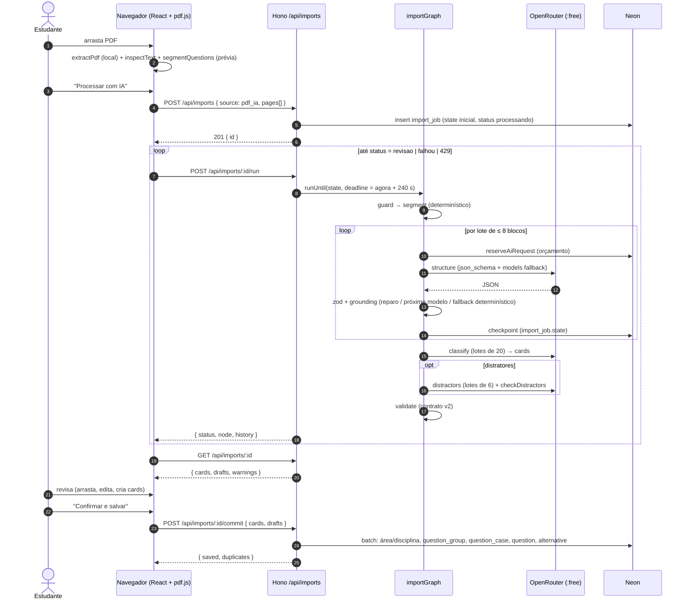

# Plano técnico — 002 Importação de questões

**Spec**: [spec.md](./spec.md) · **Tarefas**: [tasks.md](./tasks.md) · **Contratos**: [import-format-v2](./contracts/import-format-v2.md), [api-imports](./contracts/api-imports.md)

## Resumo da abordagem

1. **Cliente faz o trabalho pesado e gratuito.** pdf.js extrai o texto por página no navegador, e o guardrail e o segmentador (`shared/`) dão feedback imediato. Só o texto vai ao servidor (KBs em vez de MBs), bem abaixo dos 4,5 MB da Vercel.
2. **Servidor orquestra um grafo retomável.** `POST /api/imports` cria o job com o estado inicial do grafo. `POST /api/imports/:id/run` executa nós por até ~240 s e grava checkpoint em `import_job.state` após cada nó. O cliente chama em loop até `revisao`. Cada nó tem fallback: o pior caso é "rascunho cru para revisão", nunca perda de conteúdo.
3. **IA gratuita em 3 camadas.** (1) `models: [...]` do OpenRouter troca de modelo em erro ou rate limit; (2) a aplicação repara saídas inválidas uma vez e depois troca de elo da cadeia (`server/ai/models.ts`); (3) no fim vem `openrouter/free` e, se tudo falhar, o fallback determinístico. Um circuit breaker por modelo e um orçamento diário protegem a cota de 1000 req/dia.
4. **Agente externo e manual pulam a IA.** O JSON v2 é validado (zod) e vira o mesmo conjunto de rascunhos e cards.
4b. **Questões e gabarito separados (US6, 2026-11-22).** Vários PDFs viram UMA importação: o cliente extrai cada arquivo, junta as páginas na numeração global (`src/features/import/pdfSet.ts`) e manda `documents[]` com o papel de cada um. `shared/answer-key.ts` (`segmentImport`) segmenta as questões, lê o gabarito (outro arquivo ou seção no fim do PDF) e liga resposta → questão pelo número e item → pergunta pelo rótulo, **sem IA**, no cliente (resumo antes de processar) e no nó `segment` (mesma função). Só o que sobrar dos dois lados vai ao nó `link`, em que a IA escolhe pares de ids (nunca escreve resposta). Nada muda no banco: o estado novo (`docs`, `link`, `pendingLink`) fica no JSON de `import_job.state`.
5. **Revisão é 100% cliente.** O `ReviewBoard` (dnd-kit) mantém `cards` + `drafts` em memória. O commit envia o resultado final, o servidor revalida e grava atomicamente.

## Contexto técnico

| Item | Escolha |
|---|---|
| Extração | `pdfjs-dist` 6.5 (worker via `?url`, import dinâmico: ~134 KB gzip só ao escolher arquivo) |
| Validação | zod 4: `shared/schemas/import.ts` (contrato v2) e `server/ai/schemas.ts` (saídas dos modelos) |
| Guardrail | `shared/guardrails.ts` (regex PT/EN, invisíveis, HTML/JS, base64) + tarefa LLM `guard` |
| Segmentação | `shared/segmenter.ts` (`QUESTÃO N`, fallback numerado, subitens a–h, `reflow`) |
| Orquestração | `server/ai/graph.ts`: `StateGraph` próprio (nós, arestas condicionais, `runUntil` com prazo). ADR em [docs/09-decisoes-adr.md](../../docs/09-decisoes-adr.md) |
| IA | AI SDK 7 (`generateText` + `Output.object`) + `@openrouter/ai-sdk-provider` 3.1, plugin `response-healing` |
| Modelos | cadeias por tarefa em `server/ai/models.ts` (estrutura: ernie-5.5-flash → ling-3.2-flash → nemotron-3.5-super-vl → openrouter/free; visão: nemotron-3.5-super-vl → ling-3.2-flash → gemma-4-31b) |
| Drag-and-drop | `@dnd-kit/core` (Pointer + Keyboard sensors) + seletor "Mover para…" |
| Limites | Vercel: corpo 4,5 MB, função 300 s (`maxDuration: 300` em `vercel.json`); OpenRouter `:free`: 20 req/min, 1000 req/dia com créditos |

## Verificação da constituição

- [x] **I. Spec primeiro**: spec, contratos e tarefas antes do código de produção. O protótipo serviu para validar o layout.
- [x] **II. Usuário no controle do conteúdo**: nada é gravado sem "Confirmar e salvar". Cards e questões são totalmente editáveis, falhas de IA geram rascunhos (FR-017) e remover um card não apaga questões (FR-024).
- [x] **III. IA gratuita, resiliente e econômica**: só `:free`, fallback em 3 camadas, circuit breaker, lotes de 8, orçamento global e por usuário, agente externo como caminho de custo zero.
- [x] **IV. Segurança por padrão**: guardrail no cliente e obrigatório no servidor, delimitação com nonce, modelos sem ferramentas, grounding contra alucinação, renderização como texto e revalidação no commit.
- [x] **V. Regras compartilhadas e testadas**: contrato, guardrail e segmentador em `shared/` com vitest (`shared/__tests__/`). Os mesmos módulos rodam no cliente e no servidor.
- [x] **VI. Simplicidade serverless**: uma função Hono, passos ≤ 240 s, checkpoint em Postgres, sem fila externa (Vercel Workflows como evolução opcional).
- [x] **VII. Acessível e mobile-first**: arraste por teclado + alternativa por seletor, layout de cards responsivo, mensagens em pt-BR.
- [x] **US6 (gabarito separado)**: ligação determinística em `shared/` com testes (V); IA só para as sobras, com `:free`, orçamento e `wrapUntrusted`, e opcional (III, IV); toda resposta do gabarito aparece na revisão, ligada ou na lista "sem questão" (II); sem mudança de schema do banco nem serviço novo (VI); seletor nativo com rótulo e lista sem rolagem horizontal em 375 px (VII).

## Estrutura de arquivos

```
shared/
  schemas/import.ts                 existe  — contrato v2 (zod), LIMITS, parseImportText (```json)
  guardrails.ts                     existe  — inspectText, normalizeText, wrapUntrusted
  segmenter.ts                      existe  — segmentQuestions, reflow, heuristicKeyPoints
  prompts/external-agent.ts         existe  — prompt do agente externo
  content-hash.ts                   criar   — normalização + hash para deduplicação (cliente e servidor)
  __tests__/guardrails.test.ts      existe
  __tests__/import-and-segmenter.test.ts existe
  __tests__/content-hash.test.ts    criar
src/features/import/
  ImportPage.tsx                    existe  — métodos, stepper, PdfPanel, AgentPanel, ManualPanel, progresso (mock)
  pdfExtract.ts                     existe  — extração pdf.js + detecção de imagens/escaneado
  drafts.ts                         existe  — segmentos/JSON v2 → rascunhos + cards (classificação mock)
  ReviewBoard.tsx                   existe  — cards, dnd-kit, "Mover para", editor de card, lote de distratores
  pageImages.ts                     criar   — render de páginas em JPEG + empacotamento < 4,5 MB (Fase 2)
  useImportJob.ts                   criar   — cria job, loop de /run, polling, retomada
src/features/questions/QuestionEditor.tsx existe — editor compartilhado (alternativas, gerar com IA)
src/lib/api.ts                      criar   — (spec 001) cliente HTTP
server/
  routes/imports.ts                 existe  — POST /, POST /:id/run, GET /:id; commit = 501
  ai/graph.ts                       existe  — StateGraph, END, runUntil
  ai/pipelines/import-graph.ts      existe  — nós guard/segment/structure/classify/plan-distractors/distractors/validate
  ai/client.ts                      existe  — callStructured (3 camadas), AiUnavailableError
  ai/breaker.ts                     existe  — circuit breaker por modelo
  ai/models.ts                      existe  — cadeias por tarefa
  ai/prompts.ts, ai/schemas.ts, ai/quality.ts existe — prompts, schemas de saída, grounding/distratores
  services/taxonomy.ts              existe  — taxonomia p/ prompt, slugify
  services/import-commit.ts         criar   — commit atômico (findOrCreate, cases, hash, batch)
  ai/telemetry.ts                   criar   — gravação em ai_call (orçamento depende disso)
  routes/ai.ts                      existe  — adicionar POST /ai/distractors (editor) e POST /ai/vision (Fase 2)
  ai/eval/                          criar   — conjunto de avaliação PT-BR + script `npm run ai:eval`
```

## Modelo de dados

Tabelas em `server/db/schema.ts` (ver [docs/06-modelo-de-dados.md](../../docs/06-modelo-de-dados.md)):

- `import_job`: checkpoint do grafo em `state` (jsonb), `status` (enum `import_status`), `guardrail_risk`, `ai_requests`, `error`. Índice `(owner_id, created_at)`.
- `area`, `discipline`: taxonomia global com slug único (`discipline_area_slug`).
- `question_group`: o "card" gravado (dono, área, disciplina, assunto, descrição).
- `question_case`: texto-base compartilhado por subitens.
- `question`: `case_id` + `case_order`, `type`, `stem`, `expected_answer`, `key_points` (jsonb), `summary`, `difficulty`, `visibility`, `origin`, `has_image`, `image_description`, `content_hash` (único por dono: `question_owner_hash`), `flags`.
- `alternative`: `position`, `text`, `correct`, `explanation`, `source` (`usuario | ia`).
- `ai_call`: telemetria de cada tentativa (tarefa, modelo, ok, erro, latência, tokens), usada pelo orçamento.

Ajustes previstos: coluna `commit_result jsonb` em `import_job` (idempotência do commit) e `import_job_id` em `question` (rastreabilidade).

## Contratos

- [contracts/import-format-v2.md](./contracts/import-format-v2.md): JSON do agente externo e formato canônico dos rascunhos.
- [contracts/api-imports.md](./contracts/api-imports.md): endpoints `/api/imports*`, códigos de status e o loop do cliente.
- [contracts/api-questions.md](./contracts/api-questions.md): banco de questões (`/api/questions` CRUD manual) e `/api/taxonomy` — implementado na S1.

## Fluxo



## Riscos e mitigações

| Risco | Impacto | Mitigação |
|---|---|---|
| Lista de modelos `:free` muda ou some | Pipeline para | Cadeia configurável em `models.ts`, `openrouter/free` no fim, circuit breaker, eval periódico (`ai:eval`), fallback determinístico |
| Cota de 50 req/dia (sem créditos) | 1 PDF esgota o dia | Compra única de US$10 (1000/dia) documentada como pré-requisito, lotes de 8, agente externo em destaque |
| Modelo alucina ou reescreve questões | Banco contaminado | Grounding por trigramas, revisão obrigatória, flags visíveis |
| Prompt injection dentro do PDF | Saída manipulada / vazamento | Guardrail em camadas, nonce, sem ferramentas, schema estrito, grounding, renderização como texto |
| Job > 300 s | Timeout da função | `runUntil` com prazo de 240 s e folga de 60 s, checkpoint por nó, retomada pelo cliente |
| Texto grande demais para uma requisição | 413 | Limites por página (60k) e por job (400 páginas). O cliente divide em vários jobs se passar de ~4 MB |
| Classificação de muitas questões numa chamada estoura tokens de saída | Card "Revisar categoria" enorme | Classificar em lotes de 20 (nó `classify` em loop; feito em 2026-11-20 — com 85 questões numa chamada, só 3 vinham classificadas) |
| Distratores ruins | Simulado objetivo fraco | `checkDistractors` + reparo, etiqueta "IA" e edição manual |
| Orçamento não decrementa | Cota estourada sem controle | Gravar `ai_call` em toda tentativa (`ai/telemetry.ts`) — hoje ausente |

## Estado atual

O que já existe no repositório:

- **Protótipo funcional** (`src/features/import/*`): os três métodos, extração real com pdf.js (testada com `Unidade II.pdf`: 85 páginas, 141 itens, 135 com resposta, 33 páginas com imagem, 9 prováveis escaneadas), aviso do guardrail, validação real do JSON v2 com erros, cadastro manual, progresso simulado do pipeline, `ReviewBoard` completo (arrastar, "Mover para", editar/criar/remover card, editar/descartar questão, distratores em lote simulados) e gravação no store local.
- **Compartilhado** (`shared/*`): contrato v2, guardrail, segmentador com `reflow` e prompt do agente externo, cobertos por testes vitest (23 testes no total do repositório).
- **Servidor** (`server/*`): schema completo, `StateGraph`, grafo de importação com todos os nós e fallbacks, cliente de IA com 3 camadas e breaker, prompts, schemas de saída e checagens de qualidade, rotas `POST /`, `POST /:id/run`, `GET /:id`. Compila, mas não foi executado contra Neon/OpenRouter reais.
- **Visão (2026-11-20)**: nó `vision` no grafo (antes de `segment`), `POST /:id/images`, recortes por imagem no navegador (`pageImages.ts`, prévia "Ver recortes") e em Node (`scripts/pdf-images-node.ts`), medida com `npm run eval:import -- --vision` (docs/10 §7). Com sessão real, a tela de importação usa o job do servidor (`importJob.ts` + `useImportJob`): cria o job, envia os recortes, acompanha `/run` e abre a revisão; retomável e com tratamento de 429 (T031/T032/T036/T060). Testado de ponta a ponta contra a rota real com banco/IA simulados; ainda não contra Neon + login Google.
- **Commit (2026-11-20, S2)**: `POST /api/imports/:id/commit` grava a revisão no Neon (taxonomia por slug, cards reaproveitados, dedupe por `content_hash`, `db.batch`, idempotente); agente externo e lote manual criam o seu job; a revisão bloqueia itens inválidos (T040) e lista importações não salvas (T035). Testes de integração em `npm run test:db`.
- **Gabarito separado (2026-11-22, US6)**: vários PDFs por importação com papel por arquivo, gabarito no fim do PDF, ligação por número/rótulo (`shared/answer-key.ts`), nó `link` (IA só para as sobras), quadro "Gabarito" na revisão e `npm run eval:link` (docs/10 §10: par OSCE 135/135 questões, 366/366 perguntas, 100% no bloco certo). Testes: `shared/__tests__/answer-key.test.ts`, `server/__tests__/import-link.test.ts`, `src/features/import/__tests__/pdfSet.test.ts` (sem banco).
- **Lacunas conhecidas**: autosave das edições da revisão (T042), telemetria `ai_call` não gravada (o orçamento não decrementa), `visibility` não aceita na criação do job, colagem de múltiplos blocos JSON não suportada na UI, validação de "exatamente 1 correta" não aplicada a discursivas com alternativas.
