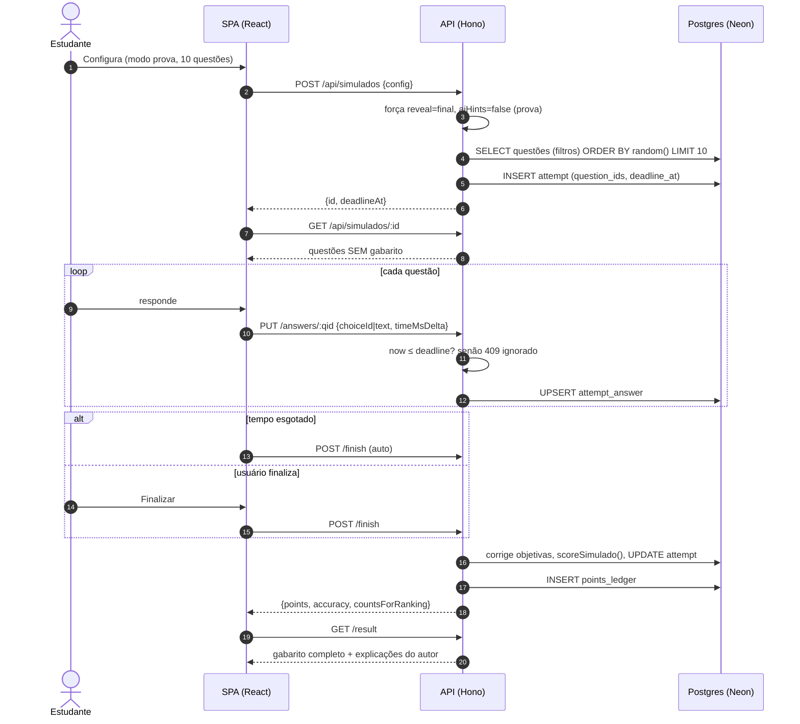

# Plano técnico — 003 Simulados

**Feature**: 003-simulados · **Spec**: [spec.md](./spec.md) · **Contrato**: [contracts/api-simulados.md](./contracts/api-simulados.md)

## Resumo da abordagem

- O **servidor** é a fonte da verdade de tudo que afeta o ranking: sorteio, prazo, sigilo do gabarito e pontuação.
- O **cliente** (React) cuida da experiência: cronômetros, navegador, atalhos, autocorreção e salvamento incremental das respostas.
- A pontuação usa a mesma função `scoreSimulado` (`shared/scoring.ts`) no cliente (prévia) e no servidor (valor oficial).
- O executor do protótipo (`src/features/simulado/SimuladoRunnerPage.tsx`) é reaproveitado. Troca-se o store mock por um cliente de API, sem mudar as telas.

## Contexto técnico

| Item | Escolha |
|---|---|
| API | Hono em `server/routes/simulados.ts`, montado em `/api/simulados` (uma função Vercel) |
| Banco | Neon Postgres + Drizzle (`attempt`, `attempt_answer`, `points_ledger`) |
| Sorteio | `ORDER BY random() LIMIT n` com filtros indexados (`question_filter`, `question_topic`); avaliar `TABLESAMPLE` acima de 100 mil questões |
| Tempo | Relógio do servidor (`startedAt`, `deadlineAt`); `timeMs` por questão informado pelo cliente e limitado à duração real |
| Validação | zod no corpo das requisições (config, respostas) |
| Frontend | React 19 + React Router 8; estado do executor local + `PUT` incremental (com debounce de 800 ms para texto) |
| Testes | vitest (regras em `shared/`), testes de contrato da API (Hono `app.request`) com banco de teste Neon branch |

## Verificação da constituição

- [x] **I. Spec primeiro**: esta spec e o contrato antecedem a implementação. O protótipo serviu para validar o layout.
- [x] **II. Usuário no controle do conteúdo**: o simulado só usa questões próprias ou públicas. A correção das discursivas é escolha do usuário (checklist ou IA).
- [x] **III. IA gratuita, resiliente e econômica**: dicas e correção por IA são opcionais e passam pelo orçamento e pelo cache (spec 005). O simulado funciona 100% sem IA.
- [x] **IV. Segurança por padrão**: gabarito, prazo e pontos ficam no servidor. Respostas após o prazo são ignoradas. A tentativa é sempre filtrada por `userId`.
- [x] **V. Regras compartilhadas e testadas**: `scoreSimulado`, `presentAs` (mover para `shared/`) e o cálculo do tempo automático têm testes vitest.
- [x] **VI. Simplicidade serverless**: as requisições são curtas (< 1 s), sem jobs longos e sem WebSocket. O executor usa polling zero (o relógio é local, ancorado no `deadlineAt`).
- [x] **VII. Acessível e mobile-first**: atalhos de teclado, `aria-label` no navegador, layout de 375 px e estados que não dependem só de cor (ícones ✓/✗).

## Estrutura de arquivos

| Caminho | Situação | Conteúdo |
|---|---|---|
| `shared/domain.ts` | existe | `SimuladoConfig`, `AnswerRecord`, `SimuladoAttempt` |
| `shared/scoring.ts` (+ testes) | existe | `scoreQuestion`, `scoreSimulado`, `performanceGrade` |
| `shared/simulado.ts` | criar | `presentAs()` (hoje em `src/mocks/model.ts`), `autoTimeLimitMin()`, `orderByCase()` |
| `shared/__tests__/simulado.test.ts` | criar | testes das funções acima |
| `server/routes/simulados.ts` | existe (parcial) | `POST /` e `POST /:id/finish` |
| `server/services/simulados.ts` | criar | sorteio, snapshot, sanitização sem gabarito, correção automática, recálculo |
| `server/routes/simulados.ts` | completar | `GET /`, `GET /:id`, `PUT /:id/answers/:qid`, `POST /:id/reveal/:qid`, `GET /:id/result`, `POST /:id/answers/:qid/grade` |
| `src/lib/api.ts` | criar | cliente tipado (`hc<AppType>` do Hono ou fetch + zod) |
| `src/features/simulado/*` | existe (protótipo) | trocar `useStore()` por hooks de API: `useCreateSimulado`, `useAttempt`, `useSaveAnswer` |
| `src/features/simulado/useCountdown.ts` | criar | relógio ancorado em `deadlineAt` (resistente a aba em segundo plano) |

## Modelo de dados

Tabelas em `server/db/schema.ts`:

- `attempt`: `config` (jsonb), `question_ids` (jsonb, ordem final), `time_limit_ms`, `started_at`, `deadline_at`, `finished_at`, `total_time_ms`, `accuracy`, `points`, `counts_for_ranking`. Índice `attempt_user (user_id, started_at)`.
- `attempt_answer`: PK `(attempt_id, question_id)`, com `position`, `choice_id`, `text`, `score`, `graded_by`, `time_ms`, `revealed_before_answer`, `used_hint`, `flagged` e `answered_at`.
- `points_ledger`: um lançamento `simulado:<modo>` na finalização e um `ajuste:correcao` em cada correção posterior de discursiva (diferença de pontos). É append-only.
- **Ajuste a fazer**: adicionar `attempt.status` (`em_andamento | finalizado | abandonado`) e `attempt_answer.presented_as` (objetiva/discursiva), para a correção usar o mesmo formato que foi exibido.

## Contratos

Ver [contracts/api-simulados.md](./contracts/api-simulados.md). Resumo:

| Método | Rota | Uso |
|---|---|---|
| POST | `/api/simulados` | cria a tentativa (sorteio + prazo) |
| GET | `/api/simulados` | histórico do usuário |
| GET | `/api/simulados/:id` | tentativa em andamento (questões sem gabarito) |
| PUT | `/api/simulados/:id/answers/:questionId` | salva a resposta + `timeMs` (idempotente) |
| POST | `/api/simulados/:id/reveal/:questionId` | treino: devolve o gabarito da questão |
| POST | `/api/simulados/:id/finish` | finaliza, corrige e pontua (idempotente) |
| GET | `/api/simulados/:id/result` | resultado + gabarito completo |
| POST | `/api/simulados/:id/answers/:questionId/grade` | corrige uma discursiva depois (checklist ou IA) |

## Fluxo

## Riscos e mitigações

| Risco | Impacto | Mitigação |
|---|---|---|
| Vazamento do gabarito pela API durante a prova | Fraude no ranking | Serializador único `toPublicQuestion()` sem campos de gabarito + teste de contrato (SC-001) |
| Usuário manipula o relógio local | Bônus de tempo indevido | Tempo oficial = `finishedAt - startedAt`, limitado ao `timeLimitMs`. O bônus usa o tempo do servidor |
| Várias abas ou requisições concorrentes no finish | Pontos duplicados | `UPDATE … WHERE finished_at IS NULL RETURNING` e ledger inserido no mesmo `db.batch` |
| `ORDER BY random()` lento com banco grande | Latência na criação | Índices de filtro; acima de 100 mil linhas, amostragem por `TABLESAMPLE SYSTEM` + filtro |
| Aba em segundo plano congela o `setInterval` | Cronômetro atrasado | O relógio deriva de `deadlineAt - Date.now()` a cada tick, nunca de um contador acumulado |
| Perda de rede no meio da prova | Respostas perdidas | Fila local (memória + `sessionStorage`) com reenvio; `PUT` idempotente |
| Farm de pontos com questões próprias fáceis | Ranking injusto | Questão própria ×0,5, repetida em 7 dias ×0,25, prova mínima de 10 questões (spec 004) |

## Estado atual

O protótipo (Fase 0) já cobre, com dados mock e em `localStorage`:
- configuração completa: modo, fonte, área, disciplinas, assuntos, tipos, quantidade, tempo automático/personalizado, revelação, dicas e prioridade de erros, com resumo e pontuação máxima;
- executor: cronômetro total/regressivo, tempo por questão, auto-finalização, navegador, marcar para revisar, riscar alternativas, atalhos, caso clínico acima do enunciado, confirmação ao finalizar e ao sair;
- correção imediata no treino (objetiva e discursiva por checklist), dica e explicação da IA (simuladas);
- resultado: acerto, pontos com detalhamento, tempos, por assunto, gabarito expansível, correção posterior por checklist/IA e "Treinar o que errei".

No servidor existem `POST /api/simulados` (sorteio + prazo) e `POST /api/simulados/:id/finish` (pontuação + ledger). Falta o restante do contrato.

## Estado atual (2026-11-20, S3)

- API completa em `server/services/simulados.ts`, com contrato v2 em [contracts/api-simulados.md](contracts/api-simulados.md):
  - prévia, criação, tentativa sem gabarito, respostas por pergunta, tempo e marcação por questão;
  - revelação no treino, finalização idempotente (ledger com índice único), resultado, correção posterior e histórico.
- **Telas na API real:**
  - O executor (`SimuladoRunnerPage`) fala com um `RunnerBackend`: `remoteBackend` na API, `localBackend` no protótipo.
  - Configuração (`useSetupSource`) e resultado (`RemoteResult`) também.
- **Testes:** `server/__tests__/simulados.db.test.ts` (`npm run test:db`).
- **Validado no navegador:** treino completo (revelar, autocorrigir, recarregar e retomar, finalizar, resultado), também em 375 px.
- **Pendente:**
  - IA no executor (dicas, explicação e correção por IA — spec 005; hoje marcadas DEMO);
  - cron de `abandonado` (T032);
  - acessibilidade do cronômetro (T033);
  - E2E com Playwright (T034).
