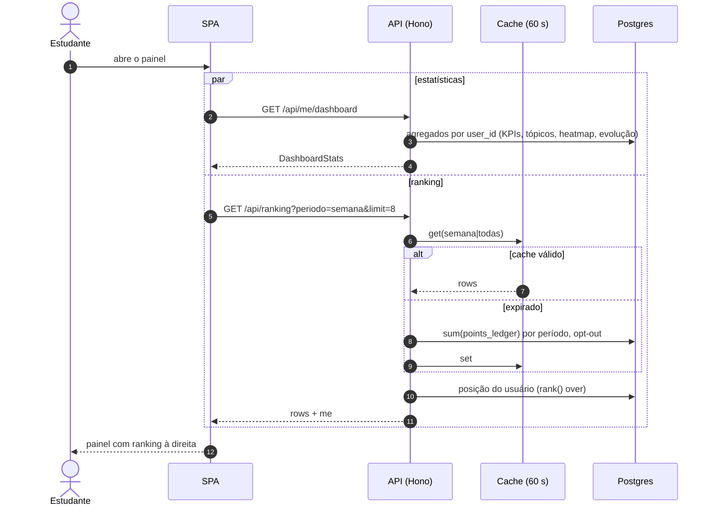

# Plano técnico — 004 Dashboard e ranking

**Feature**: 004-dashboard-ranking · **Spec**: [spec.md](./spec.md)

## Resumo da abordagem

- **Estatísticas do usuário**: calculadas sob demanda com SQL agregado sobre `attempt` e `attempt_answer`, todas filtradas por `user_id` e com índices. Não há tabela de estatísticas materializada no MVP, porque o volume por usuário é pequeno.
- **Ranking**: agregação do `points_ledger` por período, com **cache de 60 s** em memória da instância (Fluid compute) e header `Cache-Control: private, max-age=30`. Se o volume crescer, migrar para uma tabela de agregados diários (`points_daily`) atualizada na finalização do simulado.
- **Pontuação**: sempre via `shared/scoring.ts` no servidor. O ledger é append-only.

## Contexto técnico

| Item | Escolha |
|---|---|
| Rotas | `GET /api/me/dashboard`, `GET /api/ranking?periodo=semana\|mes\|geral&area=<id>&limit=50`, `GET /api/ranking/me?periodo=…`, `PATCH /api/me/profile` |
| Agregação | SQL com `date_trunc` em `AT TIME ZONE 'America/Sao_Paulo'`; `sum(points)`; window function `rank()` para a posição do usuário |
| Cache | `Map<string, {at, data}>` por período+área (60 s); invalidação suave (TTL) |
| Frontend | `DashboardPage` e `RankingPanel` existentes; trocar os dados mock por hooks `useDashboard()` e `useRanking(periodo, area)` |
| Gráficos | CSS/SVG simples (já no protótipo), sem biblioteca de charts no MVP |

## Verificação da constituição

- [x] **I. Spec primeiro**: regras de pontuação normativas nesta spec e em `docs/07-pontuacao-e-ranking.md`.
- [x] **II. Usuário no controle do conteúdo**: opt-out do ranking e nome de exibição editável.
- [x] **III. IA gratuita, resiliente e econômica**: nada aqui usa IA.
- [x] **IV. Segurança por padrão**: pontos só no servidor, ledger append-only, rate limit na criação de simulados, e-mail nunca exposto, opt-out LGPD.
- [x] **V. Regras compartilhadas e testadas**: `scoreQuestion`, `scoreSimulado` e `performanceGrade` testados. Adicionar testes de `streak` e `periodStart`.
- [x] **VI. Simplicidade serverless**: queries agregadas + cache em memória, sem fila, cron ou banco adicional.
- [x] **VII. Acessível e mobile-first**: ranking reflui para baixo em < 1280 px; cores com texto/ícone equivalente.

## Estrutura de arquivos

| Caminho | Situação | Conteúdo |
|---|---|---|
| `shared/scoring.ts` (+ testes) | existe | regras de pontos e `performanceGrade` |
| `shared/stats.ts` | criar | `computeStreak(days)`, `periodStart(periodo, now, tz)`, `accuracyBand(acc)` |
| `shared/__tests__/stats.test.ts` | criar | sequência com virada de dia BRT, início da semana na segunda, faixas de cor |
| `server/routes/ranking.ts` | existe (parcial) | `GET /api/ranking` com período e opt-out |
| `server/routes/me.ts` | criar | `GET /api/me/dashboard`, `PATCH /api/me/profile`, `GET /api/ranking/me` |
| `server/services/stats.ts` | criar | queries de KPIs, mapa por assunto, heatmap, evolução, últimos simulados |
| `server/services/ranking-cache.ts` | criar | cache de 60 s por chave |
| `server/services/anti-farm.ts` | criar | `repeatedRecently(userId, questionIds)` (7 dias) usado no finish (spec 003) |
| `src/features/dashboard/DashboardPage.tsx` | existe (protótipo) | ligar à API, estados vazios |
| `src/components/RankingPanel.tsx` | existe (protótipo) | ligar à API, filtro por área |
| `src/features/ranking/RankingPage.tsx` | existe (protótipo) | ligar à API |
| `src/features/profile/ProfilePage.tsx` | criar | nome de exibição, instituição/curso, opt-out do ranking |

## Modelo de dados

Usa as tabelas de `server/db/schema.ts`:

- `points_ledger (user_id, attempt_id, area_id, points, reason, created_at)` com os índices `ledger_period (created_at, user_id)` e `ledger_user (user_id)`.
- `attempt (user_id, started_at, finished_at, mode, accuracy, points, counts_for_ranking)` com o índice `attempt_user`.
- `attempt_answer (attempt_id, question_id, score, time_ms, answered_at)`; o join com `question (discipline_id, topic)` dá o mapa por assunto.
- `profile (show_in_ranking, display_name, institution, course)`.

Ajustes:
- Preencher `points_ledger.area_id` na finalização (área predominante do simulado), para o filtro de ranking por Área. Para simulados multiárea, um lançamento por área, proporcional.
- **Futuro** (se SC-002 falhar): tabela `points_daily (user_id, day, area_id, points)` com upsert na finalização; o ranking soma por dia.

Exemplo de query (semana):
```sql
select l.user_id, u.name, coalesce(p.display_name, u.name) as display, sum(l.points) as points
from points_ledger l
join "user" u on u.id = l.user_id
left join profile p on p.user_id = l.user_id
where l.created_at >= date_trunc('week', now() at time zone 'America/Sao_Paulo') at time zone 'America/Sao_Paulo'
  and coalesce(p.show_in_ranking, true)
group by l.user_id, u.name, p.display_name
order by points desc
limit 50;
```

## Contratos

**GET `/api/me/dashboard`** → `200`
```json
{
  "points": 3620, "rank": 4,
  "grade": { "value": 7.8, "deltaWeek": 0.4, "sample": 185 },
  "accuracy": 0.71, "answered": 185,
  "simulados": { "total": 27, "provas": 3 },
  "avgTimePerQuestionMs": 107000,
  "streak": { "current": 6, "best": 11 },
  "myQuestions": 13,
  "topics": [ { "discipline": "Ginecologia", "topic": "HPV e câncer do colo", "accuracy": 0.55, "answered": 52 } ],
  "weakest": { "discipline": "Ginecologia", "topic": "HPV e câncer do colo", "accuracy": 0.55 },
  "activity28d": [0, 4, 12, "…"],
  "evolution": [ { "attemptId": "uuid", "mode": "prova", "accuracy": 0.8, "finishedAt": "…" } ],
  "recent": [ { "id": "uuid", "title": "Ginecologia · Prova", "mode": "prova", "questions": 20, "accuracy": 0.8, "timeMin": 38, "points": 612, "finishedAt": "…" } ]
}
```

**GET `/api/ranking?periodo=semana&area=<uuid>&limit=8`** → `200`
```json
{ "periodo": "semana", "area": null, "rows": [ { "pos": 1, "userId": "…", "name": "Ana Beatriz L.", "image": "…", "institution": "Medicina · UESPI", "points": 636, "grade": 8.9, "simulados": 41 } ], "me": { "pos": 8, "points": 326 } }
```

**PATCH `/api/me/profile`**: `{ "displayName"?: string(2–40), "institution"?: string, "course"?: string, "showInRanking"?: boolean }`

## Fluxo



## Riscos e mitigações

| Risco | Impacto | Mitigação |
|---|---|---|
| Query de ranking lenta com o ledger grande | Painel lento | Índice `(created_at, user_id)`, cache de 60 s; plano B com `points_daily` |
| Fuso horário errado na virada da semana | Ranking inconsistente | `periodStart` em `shared/stats.ts` com testes; todas as queries usam `America/Sao_Paulo` |
| Farm de pontos (questões próprias, repetição, automação) | Ranking injusto | Regras anti-farm em `shared/scoring.ts`, rate limit, prova mínima de 10 e auditoria pelo ledger |
| Exposição de dados pessoais no ranking | LGPD | Só nome de exibição/avatar/instituição; opt-out; e-mail nunca serializado |
| Estatísticas divergirem entre painel e resultado | Confiança | Mesmas funções compartilhadas e testes com seed fixa (SC-003) |

## Estado atual

O protótipo cobre o layout completo:
- painel com hero + nota (anel de progresso), 6 KPIs, mapa por assunto com cores, heatmap de 28 dias, evolução prova/treino e últimos simulados;
- painel de ranking à direita com abas semana/mês/geral, top 8, linha do usuário fixada e aviso de regras;
- página de ranking com pódio e tabela.

Os dados são mock (`src/mocks/data.ts`). No servidor existe `GET /api/ranking` com período e opt-out. A rota `/api/me/dashboard` e a tela de perfil ainda não existem.

## Estado atual (2026-11-20, S3)

- **Painel:** `GET /api/stats/me` (`server/services/stats.ts`), com as regras de data e sequência em `shared/stats.ts` (testadas).
- **Ranking:** `getRanking` com nota de 30 dias, simulados e posição (`me`); opt-out oculto só para os outros.
- **Telas:** `DashboardPage`, `RankingPanel` e `RankingPage` usam `useDashboardData` e `useRankingData` (`src/features/dashboard/data.ts`), que leem da API real ou dos mocks no protótipo.
- **Estados vazios:** usuário novo e nota "—" com menos de 10 respostas.
- **"Treinar pontos fracos":** abre `/simulados?assunto=…`.
- **Pendente:**
  - seed grande e medições (T003/T026);
  - `area_id` no ledger (T007) e filtro por área;
  - rate limit (T008) e cache de 60 s (T020);
  - componente de regras (T023) e testes de fraude dedicados (T024 — finish duplicado, prazo e farm já cobertos em `simulados.db.test.ts`).

### Medição (T026, 2026-11-20)

`npm run db:seed:large -- --shared-db-ok` mede do servidor ao Neon, sem a latência da função na Vercel. Cenário: 200 estudantes, 6.000 lançamentos em 8 semanas e um estudante com 300 respostas.

| Consulta | p50 | p95 |
|---|---|---|
| Ranking semana | 72 ms | 73 ms |
| Ranking geral | 132 ms | 142 ms |
| Ranking por área | 132 ms | 146 ms |
| Painel (`/api/stats/me`) | 136 ms | 146 ms |

O plano B (tabela `points_daily`) não é necessário nesta escala.
