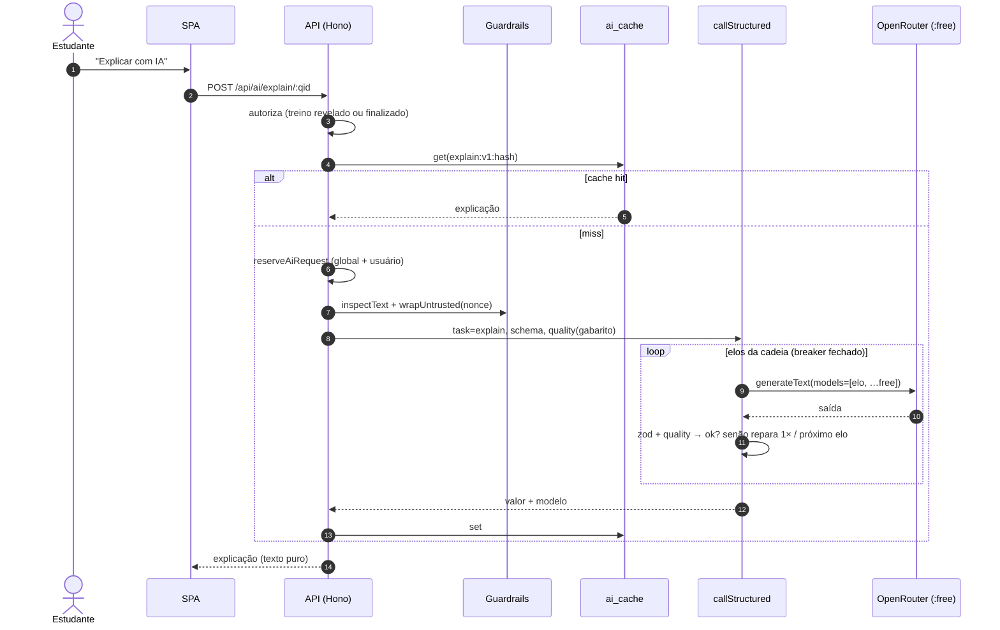

# Plano técnico — 005 IA assistente e guardrails

**Feature**: 005-ia-assistente-guardrails · **Spec**: [spec.md](./spec.md) · Arquitetura detalhada em [docs/05-pipeline-ia.md](../../docs/05-pipeline-ia.md)

## Resumo da abordagem

- **Uma porta de entrada para IA**: `callStructured()` em `server/ai/client.ts`. Toda tarefa declara um schema zod e, opcionalmente, uma checagem semântica (`quality`).
- O cliente resolve a **cadeia de modelos** da tarefa (`server/ai/models.ts`), aplica o **circuit breaker**, chama o OpenRouter via **AI SDK 7** (`generateText` + `Output.object`) com o array `models` (fallback no servidor do OpenRouter) e o plugin `response-healing`, valida, repara 1× e cai para o próximo elo.
- Os **guardrails** são camadas independentes: um falhar não derruba a proteção.
- As **funções de estudo** (explicar, dica, corrigir, distratores) ficam em `server/ai/services.ts`, com cache compartilhado e orçamento.

Decisão sobre orquestração ([ADR em docs/09-decisoes-adr.md](../../docs/09-decisoes-adr.md)): **sem LangGraph** (~98 MB e cold start maior). O pipeline de importação usa o mini `StateGraph` próprio (`server/ai/graph.ts`), com nós, arestas condicionais e checkpoint em `import_job.state`. As tarefas de estudo são chamadas únicas e não precisam de grafo.

## Contexto técnico

| Item | Escolha |
|---|---|
| SDK | `ai@7` + `@openrouter/ai-sdk-provider@3` (`compatibility: 'strict'`) |
| Saída estruturada | `Output.object({ schema })` + zod 4; `response_format: json_schema` quando o modelo suporta |
| Fallback no provedor | `extraBody: { models: [primário, ...gratuitos restantes] }` |
| Fallback na aplicação | loop por elo da cadeia: até 2 tentativas por elo (a 2ª com dica de reparo) |
| Breaker | `server/ai/breaker.ts` (memória da instância); fase 2: semear com `ai_call` das últimas 5 min |
| Orçamento | `reserveAiRequest(userId)` em `server/middleware.ts` (conta `ai_call` do dia, UTC) |
| Ritmo | 20 req/min: o pipeline espaça lotes (token bucket simples por instância) |
| Cache | `ai_cache` (Postgres); chave `tarefa:PROMPT_VERSION:sha256(conteúdo)` |
| Telemetria | `ai_call` com retenção de 90 dias |
| Guardrail determinístico | `shared/guardrails.ts` (cliente + servidor) |
| Guardrail LLM | tarefa `guard` só para risco "alto" |
| Guardrail da conta | OpenRouter Guardrails → Security → Prompt injection (flag) na chave |

## Guardrails em camadas

| # | Camada | Onde | Cobre |
|---|---|---|---|
| 1 | Filtro determinístico (normaliza, remove invisíveis/controle, regex PT/EN, HTML/script, base64) | `shared/guardrails.ts` no cliente e no servidor | "ignore as instruções…", zero-width/bidi, marcação de chat falsa, `<script>`, `javascript:` |
| 2 | Delimitação com nonce + regra de dados no system prompt | `wrapUntrusted()` + `server/ai/prompts.ts` | instruções que passaram pela camada 1 |
| 3 | Menor privilégio: modelos sem tools/URLs | `server/ai/client.ts` (não passa `tools`) | exfiltração, ações |
| 4 | Schema estrito + zod + limites de tamanho | `server/ai/schemas.ts` | saída fora do formato, payload gigante |
| 5 | Checagens semânticas (grounding, distratores, gabarito) | `server/ai/quality.ts`, `services.ts` | alucinação, resposta manipulada |
| 6 | Classificador LLM para risco alto | tarefa `guard` | ataques criativos |
| 7 | Guardrail de injeção da conta OpenRouter (flag) | configuração da chave | defesa em profundidade |
| 8 | Renderização como texto puro | React (sem `dangerouslySetInnerHTML`) | XSS via saída da IA |
| 9 | Decisões críticas no servidor | rotas de simulado/pontos | "me dê nota máxima": nota limitada a [0, 1], pontos recalculados |

## Verificação da constituição

- [x] **I. Spec primeiro**: spec, plano e corpus de avaliação antes de ligar a IA em produção.
- [x] **II. Usuário no controle do conteúdo**: toda geração (distratores, classificação) é sugestão editável; trechos sinalizados ficam visíveis na revisão.
- [x] **III. IA gratuita, resiliente e econômica**: só `:free`; 3 camadas de fallback; breaker; cache compartilhado; orçamento global e por usuário; lotes.
- [x] **IV. Segurança por padrão**: guardrails em 9 camadas; nota/pontos/gabarito no servidor; sem dados pessoais nos prompts (só conteúdo da questão).
- [x] **V. Regras compartilhadas e testadas**: `shared/guardrails.ts` com testes; adicionar testes de `quality.ts`, `breaker.ts` e `client.ts` (mock do provedor).
- [x] **VI. Simplicidade serverless**: uma função Hono; chamadas ≤ 90 s; pipeline longo dividido em passos ≤ 240 s com checkpoint.
- [x] **VII. Acessível e mobile-first**: carregamentos com texto ("Gerando explicação…"), erros com alternativa (checklist, comentário do autor).

## Estrutura de arquivos

| Caminho | Situação | Conteúdo |
|---|---|---|
| `shared/guardrails.ts` (+ testes) | existe | `inspectText`, `normalizeText`, `wrapUntrusted` |
| `server/ai/models.ts` | existe | registro por tarefa, `FREE_ROUTER`, `PROMPT_VERSION` |
| `server/ai/client.ts` | existe | `callStructured`, `AiUnavailableError`, `AttemptLog` |
| `server/ai/breaker.ts` | existe | circuit breaker em memória |
| `server/ai/prompts.ts` | existe | system prompts com regra de dados |
| `server/ai/schemas.ts` | existe | schemas de saída |
| `server/ai/quality.ts` | existe | `overlap`, `checkGrounding`, `checkDistractors` |
| `server/ai/services.ts` | existe (parcial) | `explainQuestion` (com cache), `gradeDiscursive` |
| `server/ai/graph.ts` + `pipelines/import-graph.ts` | existe | pipeline de importação (spec 002) |
| `server/routes/ai.ts` | existe (parcial) | `POST /api/ai/explain/:questionId`, `POST /api/ai/grade` |
| `server/ai/telemetry.ts` | criar | gravação em `ai_call` a partir de `onAttempt` |
| `server/ai/rate.ts` | criar | token bucket de 20 req/min por instância |
| `server/ai/services.ts` | completar | `hintForQuestion`, `generateDistractors` (avulso, para o editor) e `describeImage` |
| `server/ai/eval/` | criar | `cases/*.json` (estruturação, distratores, explicação, correção), `attacks/*.json`, `run.ts` |
| `server/__tests__/ai-client.test.ts` | criar | mock do provedor: 429 → próximo elo, JSON inválido → reparo, breaker |
| `src/lib/api.ts` | criar | `explain`, `hint`, `grade`, `generateDistractors` (substitui `src/mocks/ai.ts`) |
| `package.json` | ajustar | script `ai:eval` |

## Modelo de dados

- `ai_cache (key PK, task, model, payload jsonb, created_at, expires_at)`: explicações sem expiração (invalidadas pela versão de prompt e pelo hash do conteúdo).
- `ai_call (id, user_id, task, model, ok, error_kind, latency_ms, prompt_tokens, completion_tokens, created_at)` com os índices `ai_call_day` e `ai_call_model`. É a base do orçamento diário, do breaker persistente e da eval em produção.
- `import_job.state` guarda o checkpoint do grafo e `ai_requests` o consumo por job.
- `attempt_answer.used_hint` e `graded_by = 'ia'` registram o efeito das funções de estudo na pontuação.

## Contratos

| Método | Rota | Corpo | Resposta |
|---|---|---|---|
| POST | `/api/ai/hint/:questionId` | `{ attemptId }` | `{ dica }`; marca `used_hint`; 403 se prova/sem `aiHints`/já respondida |
| POST | `/api/ai/explain/:questionId` | `{ attemptId? }` | `{ dica, por_alternativa[], resumo, cached }`; 403 em prova em andamento |
| POST | `/api/ai/grade` | `{ questionId, answer }` | `{ pontos[], nota, feedback }` (a pontuação é aplicada pela rota de simulado, spec 003) |
| POST | `/api/ai/distractors` | `{ stem, expectedAnswer, keyPoints?, correctText? }` | `{ alternativas[] }` (editor de questões) |
| — | erros | — | `429` orçamento (mensagem amigável) · `503` IA indisponível (com alternativa na UI) |

## Fluxo

## Riscos e mitigações

| Risco | Impacto | Mitigação |
|---|---|---|
| Modelos gratuitos somem/mudam | Funções quebram | Registro único por tarefa, `openrouter/free` como último elo, `npm run ai:eval` mensal, fallback determinístico |
| Cota de 50/dia (sem créditos) | IA inviável | Compra única de US$10 → 1000/dia (ponto em aberto 1); cache; lotes; modo "agente externo" como alternativa sem custo |
| Injeção bem-sucedida | Notas/explicações manipuladas | Guardrails em camadas; nota limitada e pontos no servidor; corpus de ataques no CI (SC-001) |
| Alucinação (explicação errada) | Ensina errado | Gabarito como fonte, checagem de contradição, comentário do autor priorizado, botão "reportar explicação" (fase 3) |
| Breaker em memória não compartilhado entre instâncias | Chamadas desperdiçadas | Semear o breaker a partir do `ai_call` recente (fase 2); TTL curto |
| Privacidade (free models podem logar prompts) | Exposição de dados | Prompts só com conteúdo da questão, nunca nome/e-mail; aviso na política de privacidade |
| Latência alta de modelos gratuitos | UX ruim | Timeout por tarefa, mensagens de progresso, cache, explicação pré-gerada em segundo plano para questões públicas populares (fase 2) |

## Estado atual

- **Pronto e testado**: `shared/guardrails.ts` (7 testes) usado no protótipo (importação via PDF e via agente externo exibem alertas do guardrail).
- **Esqueleto que compila** (sem testes de integração): `server/ai/{models,client,breaker,graph,prompts,schemas,quality,services}.ts`, `server/ai/pipelines/import-graph.ts`, `server/routes/ai.ts`, `reserveAiRequest`.
- **Protótipo de UI**: dica, explicação por alternativa, correção de discursiva e geração de distratores, todos simulados em `src/mocks/ai.ts` com o selo "demo".
- **Falta**: telemetria em `ai_call`, ritmo de 20 req/min, rotas de dica/distratores, eval e corpus de ataques, testes do cliente com provedor mockado, e autorização das rotas de IA pelo estado da tentativa.
